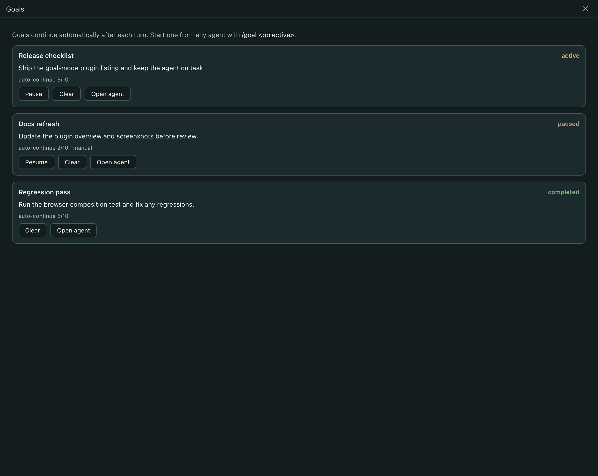

# Goal Mode

Goal Mode keeps a Paseo agent working on one objective across turns. Start a goal with `/goal <objective>` and the plugin sends a kickoff message, then follows up after each finished turn until the agent reports success, reports a blocker, or reaches the auto-continue limit.

## Usage

- `/goal <objective>` starts or replaces the current goal.
- `/goal status` shows the goal for the current agent.
- `/goal pause` and `/goal resume` control automatic continuation.
- `/goal clear` removes the goal.
- `/goal --max=N <objective>` changes the auto-continue limit from 1 to 100.

The Goals screen lists goals on the connected host and offers pause, resume, clear, and open-agent actions. It is available from the sidebar and the command center.

## Install

Install `37chengshan/paseo-goal-mode` from the plugin browser, or use the Paseo CLI plugin install command with the repository URL.

## Storage

Goals are stored per agent in `~/.paseo/plugin-state/goal-mode.json` on the daemon host. Marker scanning and follow-up sends happen on that host; no goal data is sent anywhere else. The agent's normal provider traffic still applies.

Requires Paseo 0.11.4 or newer.
